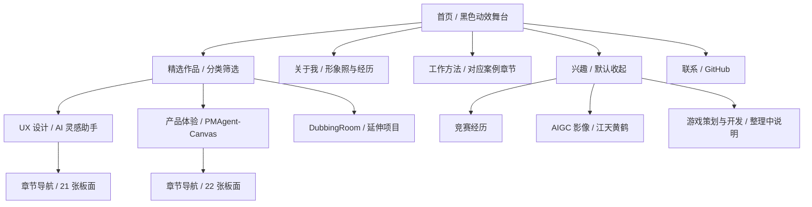

# 纯黑实验视觉：实现与验收

日期：2026-09-17。分支：`feat/personal-portfolio-experience`。本轮为当前工作目录中的页面实现；线上发布状态独立于本地分支。

## 当前结构

职业案例优先；兴趣通过原生 `details` 展开。游戏类目前只有真实的分类意向和整理状态，没有虚构案例或无效按钮。DubbingRoom、江天黄鹤及 44 张板面的原有路径均保留。

## 交互与维护入口

| 效果 | 实现方式 | 维护入口 |
| --- | --- | --- |
| 首屏循环动效 | 四张作品画面缓慢漂浮；形象照周围的细环轻缓转动 | `custom.css` 的 hero 段；`index.html` 的 `.hero-gallery` |
| 鼠标显影 | 暗图层上叠一层同源图像，通过径向透明遮罩局部点亮 | `.hero-lit`、`--spot-x/y`；默认显影半径 350px |
| 触屏探索 | 轻触或滑动时更新局部光点；不阻止页面滚动 | `main.js` 的 pointer 事件 |
| 动效暂停 | 用户可暂停；首屏离开视口/页面进入后台时也暂停循环 | `motion-toggle`、`ambient-paused`、`page-idle` |
| 卡片渐入 | 原生滚动进度驱动透明度、轻微上移与缩放；首次完整出现后保持可读 | `[data-scroll-reveal]`；位移 65px、约 1/3 视口渐入 |
| 分类筛选 | 全部 / UX / 产品；保持真实链接和屏幕阅读器状态 | `data-filter`、`data-category`、`aria-pressed` |
| 局部悬浮 | 图片聚光、轻微抬升、局部「查看案例」提示；主 CTA 小幅磁吸 | `[data-spotlight]`、`[data-magnetic]` |
| 兴趣展开 | 点击、Enter 或 Space；导航与直接访问 `#interests` 会展开 | `#interest-disclosure` |
| 案例阅读 | 吸顶章节目录、阅读进度、原生 dialog 图片阅读器 | `.case-toc`、`.case-section[id]`、`.board-dialog` |
| 图片阅读器 | 上/下一张、原尺寸缩放、原图链接、Escape 关闭及焦点返回 | `main.js` 的 boardLinks 段 |

连续动画只在首屏生效。鼠标更新使用请求帧合并，未引入全局尾迹、WebGL、React 或新的运行依赖。主内容不依赖悬浮才能出现；减少动效模式关闭循环、跟随和滚动渐入。无 JavaScript 时，作品链接、原图链接、手机导航和兴趣展开仍可使用。

`style.css` 保留上游模板；新样式集中在 `custom.css`，使用明确的分段与颜色变量。导航在四页同步，手机按钮使用 `#menu-toggle`，避免原模板 `#hamburger` 的高优先级规则冲突。详情页新增章节锚点，不改变旧板面锚点。

## 参考与实现边界

- [抖音小游戏](https://game.open-douyin.com/)：实际浏览首屏及下滑过程，参考黑色空间、暗处画面、集中信息与逐渐出现的卡片节奏。使用本人的形象照和项目图片，以 CSS 动效替代视频；没有复制该站素材或商业数据。
- [React Bits](https://www.reactbits.dev/get-started/index)：参考 Spotlight、Magnet 等局部交互模式；本站为原生实现，没有导入该库或复制其组件代码。
- [W3C Disclosure](https://www.w3.org/WAI/ARIA/apg/patterns/disclosure/) 与 [web.dev 动画指南](https://web.dev/articles/animations-guide)：用于展开操作、键盘与动画性能的基线。

## 验收方法

运行 `python scripts/verify_portfolio.py`。五组首页视口为 360×740、390×844、768×1024、1440×900、1920×1080；三个详情页另测 390 与 1440 宽度。脚本检查网页错误、失败请求、横向溢出、分类筛选、键盘与触屏、图片切换及缩放、焦点返回、主题记忆、减少动效切换和无 JS 使用。

本轮结果：全部检查通过。五组首页视口无横向溢出、页面错误或失败请求；三个详情页在两种宽度下的章节跳转与阅读器通过，板面数分别为 21 / 22 / 1。已人工查看桌面、平板、手机、显影状态、兴趣展开、浅色主题和图片阅读器截图，并修复旧模板菜单 ID 的尺寸冲突与章节跳转的偏移问题。静态链接、锚点、JavaScript 语法、Markdown 链接及 Git 空白检查通过。

截图与 JSON 报告保存在 `.local/acceptance/`，只用于本地验收。浏览器测量来自本机 Edge/Chromium，不能替代真实设备 Safari、Firefox 或线上网络环境的性能测试。新增文件后继续运行链接检查；更换板面数量时同步更新验收预期。
