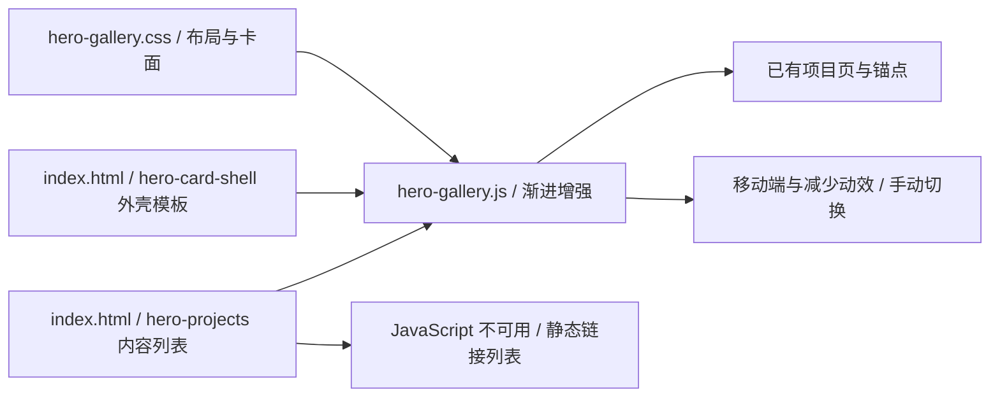

# 首屏作品收藏卡：结构与维护

更新：2026-09-21。分支：`fix/hero-natural-flow`。

首屏左侧是个人介绍，右侧是五张真实作品入口。桌面自动向下翻转，手机和平板原生左右滑动；与下方斜向聚光作品墙各自独立。

## 结构与职责



- `index.html`：唯一作品内容源、共用卡背模板。原始链接始终可用。控制按钮和独立计数栏已移除，不再预留底部控制区。
- `hero-gallery.css`：首屏布局、响应式、卡片正反面、边缘和视觉层级。仅首页引用。
- `hero-gallery.js`：单个闭包，管理周期、姿态、播放条件、焦点与手动切换；不污染 `main.js` 全局变量。
- `main.js`：继续负责导航、主题、斜向图片墙、筛选、兴趣和案例阅读器。首屏已不使用旧显影或全局暂停状态。

## 新增或调整卡片

在 `.hero-projects` 的列表末尾增加一条记录。顺序就是播放顺序，无需调整 JavaScript 或卡背编号：

```html
<li data-project="my-project" style="--card-accent: #9dbdff">
  <a href="projects/my-project.html" class="hero-project-link">
    
    <span class="hero-project-category">UX DESIGN</span>
    <h2 class="hero-project-title">项目名称</h2>
  </a>
</li>
```

- `data-project` 使用唯一稳定标识；类别供阅读，不参与过滤算法。
- 链接采用相对路径，兼容 GitHub Pages 的项目路径前缀。详情页及锚点必须先存在。
- 强调色只用于类别、背面标识与小面积装饰。不要将整张卡改成高亮背景。
- 0 张隐藏组件；1 张正面静态展示且无控制栏；2 张及以上自动计算循环和编号。没有固定五张的布局判断。
- 内容变更在刷新时初始化；本站没有运行时后台或动态增删接口。

## 封面与素材

**宽图、竖图均保持原始比例，使用 `object-fit: contain` 完整呈现。禁止拉伸、强制裁断或把横图旋转成竖图。** 留白由深色外壳统一承接；此规则同时写在 HTML 和 CSS 注释里。

建议封面最长边 1200–1600px、WebP 格式；优先展示可辨识的项目主视觉，而不是要求访客在首屏阅读整张设计板面。

| 内容 | 发布资源 | 来源 / 处理 |
| --- | --- | --- |
| AI 灵感助手 | `assets/images/inspiration-cover.webp` | 沿用已有封面 |
| PMAgent-Canvas | `assets/images/pmagent-cover.webp` | 沿用已有封面 |
| DubbingRoom | `assets/images/hero/dubbingroom.svg` | 原创文字与抽象声波图形，不代表产品界面 |
| 江天黄鹤 | `assets/images/hero/jiangtian.webp` | `../作品集+附件/AIGC视频创作/江天黄鹤.jpg`，等比压缩到 1200×675 |
| Vivo 创意广告 | `assets/images/hero/vivo.webp` | `../作品集+附件/AIGC视频创作/Vivo创意广告封面.jpg`，等比压缩到 1200×675 |

视频文件没有加入首屏加载。Vivo 的稳定入口为 `projects/other.html#vivo`，仅补充现有素材支持的图文内容。

## 动效规则与参数

| 参数 / 行为 | 当前值与调整入口 |
| --- | --- |
| 桌面断点 | CSS 与 JS 均为 1024px，改动时必须同步 |
| 桌面卡片宽度 | `min(76%, 360px)`；手机卡片按容器宽度，保证阅读 |
| 卡片比例 | 1.4；修改后检查标题和封面容器，不改变图片自身比例 |
| 摄像机透视 | 1350px；只应用在卡片视口 |
| 播放周期 | JS `PERIOD = 8000`，实际时间驱动，5 张约 40 秒一轮 |
| 中心停留 | 每次过渡两侧各 1 秒，合计约 2 秒停留；中间 6 秒 smoothstep 流动 |
| 移动方向 | 正进度沿 Y 轴向下；下一张从上方进入 |
| 旋转 / 错位 | 基础平面倾角 -3°，沿轨迹约 ±22px 横向错位；绕 X 轴翻转最大 175° |
| 悬停反馈 | 鼠标相对卡片的坐标控制 Y 轴 ±6°、X 轴 ±4°，110ms 时间常数缓动；远端卡片反馈衰减 |
| 循环换位 | 模运算换位前，在不可见远端渐隐，避免接缝 |
| 可点击范围 | 正面可见且亮度足够时可点击；背面和不可见卡片不接收点击 |

正反面之间有独立厚度层。3D 祖先不能使用 `opacity < 1`、滤镜或遮罩，否则浏览器会压平立体结构；透明度设置在各卡面，边缘遮挡由视口伪元素实现。

## 播放、焦点和降级

- 自动播放要求：桌面、未开启减少动效、多于一张、鼠标不在作品区、卡片未获得键盘焦点、视口可见、页面在前台。
- 悬停暂停位移，但允许独立的倾斜缓动；移开后缓慢归零，焦点移出作品区后自然继续。倾斜收敛后关闭对应 RAF。
- 键盘聚焦作品后可使用左右方向键切换，焦点离开时自然恢复播放，不存在等待已删除按钮才能恢复的暂停状态。
- 桌面只有当前项目进入 Tab 顺序，方向键可访问其他项目；静态滑动列表的全部卡片都可通过 Tab 访问。自动播放不做读屏播报；手动切换通过状态区播报。
- 手机、平板、减少动效模式显示原生横向 scroll-snap 列表，直接滑动卡片；保留页面纵向滚动，不显示按钮或滚动条。
- 媒体偏好在 `change` 事件更新缓存，避免每帧读取媒体查询；屏幕尺寸变化也会重新测量轨迹。
- 图片失败时仍保留项目标题及链接；JS 失败时，原始静态列表保留所有项目入口。

## 验收与本地输出

启动现有本地服务器后：

```powershell
$env:PYTHONDONTWRITEBYTECODE='1'
python scripts/verify_portfolio.py
python scripts/verify_hero_gallery.py
```

- 通用验收覆盖导航、作品墙、筛选、主题、折叠与 44 张案例板面，输出 `.local/acceptance/`。
- 首屏验收覆盖 360/390/768/1024/1440/1920px、五个入口、悬停、键盘、动态偏好、离屏与后台处理、无 JS、封面失败及 0/1/2/6 张卡片；输出 `.local/hero-collection/`。
- 自动播放验收按真实时间观察 80 秒，保存 11 个中心停留节点及运动中截图。
- 临时目录、截图、报告都在当前 F 盘仓库内，不进入 Git。原始素材目录和参考文件不作为发布资源打包。

维护后检查文件职责与稳定链接，运行 `codegraph sync .` 更新已存在的索引。CodeGraph 不覆盖 HTML/CSS，因此内容源与样式关系仍以此文档为准。

### 本轮验收记录

无控制栏修订：再次通过六种宽度和两轮 80 秒轮播；首屏不存在按钮、计数栏或控制区 DOM。额外使用浏览器触摸事件验证手机滑动至第二张，验证键盘焦点移出后继续播放及桌面/手机断点实时切换。对应截图为 `.local/hero-collection/natural-desktop.png` 与 `natural-mobile-swipe.png`。

2026-09-21：两份验收脚本均通过。六个宽度无横向溢出；两轮真实播放的 11 个节点顺序为 1→2→3→4→5→1→2→3→4→5→1，中心姿态均通过检查。已检查悬停倾斜截图、手机卡片截图及封面失败降级。后台逻辑通过模拟 `visibilitychange` 和 `document.hidden` 测试，离屏暂停通过实际滚动测试。五个项目入口、减少动效实时切换、无 JS 和不同数量内容记录均通过。通用回归覆盖原作品墙与三份详情页的 44 张板面。
